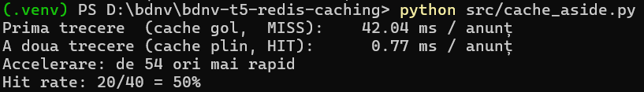
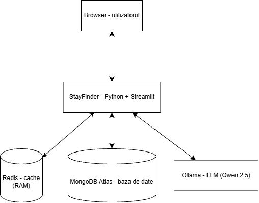

# T5 – Caching și accelerarea accesului la date cu Redis

**StayFinder** este o platformă simplă de căutare a cazărilor (setul de date `sample_airbnb` din MongoDB Atlas), cu Redis ca nivel de cache între aplicație și baza de date.

## Pornire

Necesită Python 3.11+, Docker Desktop și un cluster MongoDB Atlas cu `sample_airbnb` încărcat.

```powershell
docker compose up -d
python -m venv .venv
.venv\Scripts\activate
pip install -r requirements.txt
Copy-Item .env.example .env   
python src/cache_aside.py
```

## Rezultate



Fără cache: 42 ms / anunț · Cu cache: 0.77 ms / anunț · ~54× mai rapid

## Arhitectură

